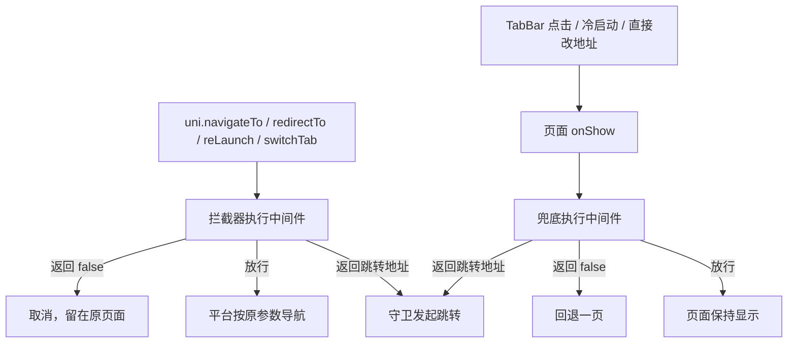

中间件写在 `src/middleware` 目录里。构建时插件扫描该目录并生成虚拟模块，运行时在跳转发生前执行中间件。返回值决定放行、取消或改道。

页面和全局都可以挂中间件。

## 安装

:pm-install{name="-D @uni-helper/vite-plugin-uni-middleware"}

## 使用

### 注册插件

```ts [vite.config.ts]
import Uni from '@dcloudio/vite-plugin-uni'
import UniMiddleware from '@uni-helper/vite-plugin-uni-middleware'
import { defineConfig } from 'vite'

export default defineConfig({
  plugins: [Uni(), UniMiddleware()],
})
```

### 编写中间件

```ts [src/middleware/auth.ts]
import { defineMiddleware } from '@uni-helper/vite-plugin-uni-middleware/runtime'
import { useStore } from '../store'

export default defineMiddleware((to) => {
  const store = useStore()
  if (!store.isLogin) {
    return '/pages/login/index'
  }
})
```

### 挂到页面

```jsonc [src/pages.json]
{
  "pages": [
    { "path": "pages/index/index" },
    { "path": "pages/vip/index", "middleware": ["auth"] }
  ]
}
```

### 注册守卫

必须把虚拟模块导出的中间件表传给 `createNavigationGuardPlugin`：

```ts [src/main.ts]
import { createNavigationGuardPlugin } from '@uni-helper/vite-plugin-uni-middleware/runtime'
import { middlewares } from 'virtual:uni-middleware'
import { createSSRApp } from 'vue'
import App from './App.vue'

export function createApp() {
  const app = createSSRApp(App)
  app.use(createNavigationGuardPlugin(middlewares))
  return { app }
}
```

需要类型提示时，在 `env.d.ts` 里加一行：

```ts [src/env.d.ts]
/// <reference types="@uni-helper/vite-plugin-uni-middleware/client" />
```

## 拦截方式

守卫有两个入口，覆盖 uni-app 的所有页面进入方式。

### 导航 API 拦截器

`uni.navigateTo`、`uni.redirectTo`、`uni.reLaunch`、`uni.switchTab` 调用时先执行中间件。被拦下的跳转不会发生，页面不会渲染，页面栈也不会多出一层。

中间件是同步函数时，放行的跳转由平台原样执行。中间件返回 Promise 时，守卫先取消这次跳转，等结果出来再自己发起。

### onShow 兜底

三类入口不经过上面四个 API：TabBar 点击（微信小程序点击 TabBar 走原生逻辑，不触发 `uni.switchTab`）、小程序冷启动、H5 直接改地址栏。

页面显示后守卫再执行一次中间件。需要改道时再跳走。这条路径上页面已经渲染出来，会看到一次短暂的闪现。



两条路径不重复执行同一组中间件。拦截器放行的页面显示时直接跳过。同一页面反复 `onShow`（例如从后台切回）也只执行一次。

两个页面互相跳转会被拦住：守卫记录已经离开的页面，发现又跳回时停止跳转并报错。

## 中间件返回值

| 返回值 | 行为 |
| --- | --- |
| `undefined` / `true` | 放行 |
| `false` | 取消本次导航。页面已经显示时回退一页；页面栈只有这一页时只报错 |
| `string` | 当作跳转地址，用 `uni.redirectTo` 跳转 |
| `{ url, method?, options? }` | 指定跳转方式。`method` 默认 `redirectTo`，可选 `navigateTo`、`redirectTo`、`reLaunch`、`switchTab` |

多个中间件按「全局 → 页面」的顺序执行。遇到第一个不放行的结果就停下，后面的中间件不再执行。

中间件抛出的异常打印到控制台，然后继续执行下一个中间件，不会把用户卡在页面上。

中间件可以返回 Promise，守卫会等它结束再决定：

```ts
export default defineMiddleware(async (to) => {
  if (!(await checkToken())) {
    return { url: '/pages/login/index', method: 'reLaunch' }
  }
})
```

`to` 和 `from` 是页面地址，不是页面实例：

```ts
interface RouteLocation {
  /** 页面路径，不带前导斜杠，如 pages/login/index */
  route: string
  /** 完整地址，带前导斜杠和查询串，如 /pages/login/index?from=home */
  url: string
}
```

`onShow` 兜底时拿不到查询串，`from` 的 `url` 只有 `/${route}`。

## 页面配置

默认直接写 `pages.json`：

- 顶层 `middleware` 是全局中间件，每个页面都会跑。
- `pages[].middleware` 只作用于这一页。
- 全局中间件排在页面中间件前面。同一层按 `middleware` 数组的顺序执行，同一个名字写两遍也只跑一次。
- 名字在 `src/middleware` 里找不到时构建失败，终端列出已扫描到的名字。

```jsonc [src/pages.json]
{
  "middleware": ["global"],
  "pages": [
    { "path": "pages/index/index" },
    { "path": "pages/vip/index", "middleware": ["auth", "vip"] }
  ]
}
```

### 中间件名

中间件名按路径推导，不等于文件名：

1. 取文件名，去掉扩展名。
2. 文件名是 `index` 时，改用所在目录名。
3. 目录段从外往里拼到文件名前面，遇到与文件名第一段相同的目录段就停下。
4. 拼好的各部分转 PascalCase，再转 camelCase。

`pages.json` 里写的名字就是第 4 步的结果。

| 文件 | 中间件名 |
| --- | --- |
| `auth.ts` | `auth` |
| `vip/index.ts` | `vip` |
| `user/profile.ts` | `userProfile` |
| `user/user-list.ts` | `userList` |
| `blog/posts/index.ts` | `blogPosts` |

`user/user-list.ts` 的目录段与文件名第一段都是 `user`，重复部分被去掉，只剩 `userList`。目录名与文件名都按大小写、`-`、`_` 切开，`user-list` 与 `userList` 等价。

统一转 camelCase，是为了让嵌套目录写成扁平的键：`vip/auth.ts` 对应 `vipAuth`。写进 `pages.json` 时不用关心分隔符用 `/`、`-` 还是 `.`。

名字写错时构建失败，失败信息写出引用它的页面与所有可用的名字：

```text
[vite-plugin-uni-middleware] 找不到中间件 "hi-guard"，引用位置为 页面 pages/hi，已扫描到的中间件包括 auth、global、userProfile、userList、vip
```

### 配合 vite-plugin-uni-pages

[vite-plugin-uni-pages](https://github.com/uni-helper/vite-plugin-uni-pages) 扫描页面后生成 `pages.json`，本插件读的是生成后的文件。两者一起用时，建议把 `UniPages()` 写在 `UniMiddleware()` 前面：

```ts [vite.config.ts]
import Uni from '@dcloudio/vite-plugin-uni'
import UniMiddleware from '@uni-helper/vite-plugin-uni-middleware'
import UniPages from '@uni-helper/vite-plugin-uni-pages'
import { defineConfig } from 'vite'

export default defineConfig({
  plugins: [UniPages(), Uni(), UniMiddleware()],
})
```

全局中间件写在 `pages.config.ts`：

```ts [pages.config.ts]
import { defineUniPages } from '@uni-helper/vite-plugin-uni-pages'

export default defineUniPages({
  middleware: ['global'],
})
```

页面级中间件写在页面文件的 `definePage` 里：

```vue
<!-- src/pages/vip/index.vue -->
<script setup lang="ts">
definePage({
  middleware: ['auth', 'vip'],
})
</script>
```

uni-pages 0.4 起移除了 `<route>` 自定义块。写在那里的字段进不了 `pages.json`，页面级配置只能写在 `definePage` 里。

`middleware` 没有专门的类型声明。`PageItem` 带字符串索引签名，名字写错不会有编辑器提示，只能等构建期报错。

`definePage` 是全局宏。编辑器要认识它，必须引用 uni-pages 的类型：

```ts [src/env.d.ts]
/// <reference types="@uni-helper/vite-plugin-uni-pages/client" />
```

## 工作方式

构建期：

1. 扫描 `middlewareDir`，按文件路径推导中间件名。
2. 读取 `pages.json`，把顶层 `middleware` 与 `pages[].middleware` 里的名字换成扫描到的函数。名字不存在时构建失败。
3. 生成虚拟模块 `virtual:uni-middleware`。开发时改中间件或 `pages.json` 会触发整页刷新。

运行期：

1. `main.ts` 导入虚拟模块，把中间件表交给 `createNavigationGuardPlugin(middlewares)`，再用 `app.use()` 注册拦截器与 `onShow` 兜底。
2. 导航时按「全局 → 页面」执行中间件，第一个不放行的结果决定后续。
3. 中间件放行就按原参数继续，返回跳转就改道，返回 `false` 就取消或回退。

中间件表经过 `main.ts` 传递。uni-app 小程序构建把 `node_modules` 里的代码打包进 `common/vendor`，项目文件各自一个 chunk。运行时自己导入虚拟模块时，`common/vendor` 与中间件 chunk 会互相 `require`。

两个文件推导出同一个名字时，先扫到的文件生效，构建期给出警告。

## 已知问题

- TabBar 点击、冷启动、H5 直接改地址只能等页面显示后判断，受保护的页面会先渲染出来。要求完全不闪现时，把受保护页面放在普通页面里，不要放进 TabBar。
- 被拦下的导航不会触发 `success` 与 `fail`，这是 uni-app 拦截器本身的行为。中间件给了跳转地址时，调用方的回调会挂到那次跳转上。
- 守卫跑在客户端，只能管界面。接口权限仍然必须在服务端校验。
- H5 与小程序已用 playground 构建验证。App 平台未验证。

## 配置

| 字段 | 类型 | 默认值 | 说明 |
| --- | --- | --- | --- |
| `middlewareDir` | `string` | `"src/middleware"` | 中间件目录 |
| `pagesJsonPath` | `string` | `"src/pages.json"` | `pages.json` 的路径 |
| `programRoot` | `string` | `process.cwd()` | 上面两个相对路径的根目录 |

配置项的完整定义见 [types.ts](https://github.com/uni-helper/vite-plugin-uni-middleware/tree/main/src/types.ts)。

## API

### defineMiddleware

```ts
function defineMiddleware(middleware: Middleware): Middleware
```

原样返回传入的函数，只用来拿类型提示。

### createNavigationGuardPlugin

```ts
function createNavigationGuardPlugin(middlewares: MiddlewareMap): ObjectPlugin
```

创建 Vue 插件，在 `main.ts` 里用 `app.use()` 注册。`middlewares` 就是虚拟模块 `virtual:uni-middleware` 导出的映射。

注册会做两件事：给四个导航 API 添加拦截器，以及给所有页面混入 `onShow` 兜底。

中间件表必须由调用方传进来。运行时不导入虚拟模块：虚拟模块导入中间件文件，中间件文件通常又导入运行时（`defineMiddleware`，或自己的 store），uni-app 会把这两头分到互相 `require` 的 chunk 里。构建会报 `Circular chunk`，小程序产物里的 `middleware/*.js` 还会在 `common/vendor.js` 定义导出之前调用它。

### 类型

```ts
type Middleware = (to: RouteLocation, from?: RouteLocation) => MiddlewareReturn | Promise<MiddlewareReturn>

type MiddlewareReturn
  = | void
    | boolean
    | string
    | {
      url: string
      method?: 'navigateTo' | 'redirectTo' | 'reLaunch' | 'switchTab'
      options?: Record<string, unknown>
    }
```
