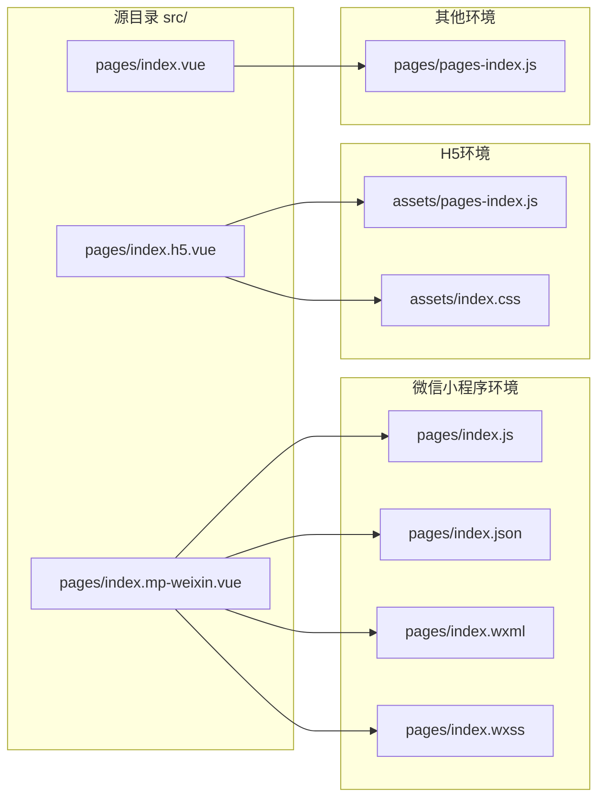
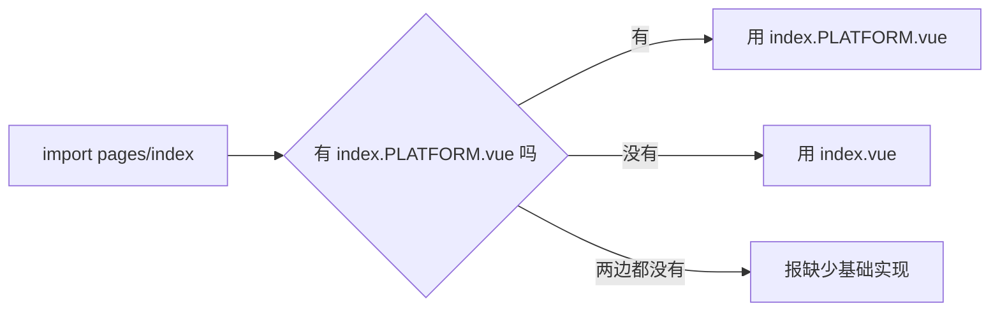

本插件按文件名分流平台代码：`index.h5.vue` 只在 H5 生效，`index.mp-weixin.vue` 只在微信小程序生效。

不用在源码里堆 `#ifdef`。带平台后缀的文件只在对应平台参与构建，其他平台看不到它。

插件只替换路径，不改写文件内容，所以 `.vue`、`.ts`、`.scss` 的处理方式相同。平台的判断依据是 `UNI_CUSTOM_SCRIPT` 或 `UNI_PLATFORM`，自定义编译脚本（例如 `uni -p h5-weixin`）也能用。

## 安装

:pm-install{name="-D @uni-helper/vite-plugin-uni-platform"}

peer 依赖是 `vite ^5.0.0`。

::alert{type="warning"}
本插件只发布 ESM 产物，`exports` 只有 `import` 字段。Vite 配置文件必须按 ESM 加载：命名为 `vite.config.mts`，或者在 `package.json` 里设置 `"type": "module"`。0.1.x 同时提供 CJS 与 ESM 入口。

配置按 ESM 加载后，`@dcloudio/vite-plugin-uni` 的 CJS 默认导出拿到的是模块对象，不是函数。必须换成 [@uni-helper/plugin-uni](https://github.com/uni-helper/plugin-uni) 的 ESM 导出。
::

## 使用

```ts [vite.config.mts]
import Uni from '@uni-helper/plugin-uni'
import UniPlatform from '@uni-helper/vite-plugin-uni-platform'
import { defineConfig } from 'vite'

export default defineConfig({
  plugins: [
    UniPlatform(),
    Uni(),
  ],
})
```

目录里准备两份文件：

```text
src/pages/index.vue           # 所有平台的基础版本
src/pages/index.h5.vue        # 只在 H5 生效，覆盖上面的基础版本
src/pages/index.mp-weixin.vue # 只在微信小程序生效
```

构建 H5 时，`pages/index` 用 `index.h5.vue`。构建微信小程序时，`pages/index` 用 `index.mp-weixin.vue`。



## 扫描规则

平台名来自 `@uni-helper/uni-env`。存在 uni-app 自定义编译脚本时取 `UNI_CUSTOM_SCRIPT`，否则取 `UNI_PLATFORM`。

判定只看文件名：去掉扩展名后以 `.{platform}` 结尾就算。后缀必须加在文件名最后一个点之前，目录名里的点不算。

```text
pages/index.h5.vue          # 算，H5 的页面
pages/v1.2/detail.h5.vue    # 算，H5 的页面；v1.2 是目录名
pages/v1.2/detail.vue       # 不算
```

## 处理规则

`resolveId` 依次做三件事：

1. 导入本来就有当前平台后缀时，交给后面的插件。
2. 原路径能解析时，交给 `load` 处理。`load` 先找当前平台的平台文件：存在就用它，否则用原文件。
3. 原路径解析不到时，拼上当前平台再解析一次。解析到就用平台文件；小程序端的 `.vue` 返回平台文件自己的路径，其余情况返回拼接后的结果。

两条路都失败时构建报错。报文带「缺少基础实现」，与 Vite 默认的 `Cannot find module` 区分：

```text
缺少基础实现：无法解析 "/abs/src/platform/greeting"。基础文件不存在，当前平台 mp-weixin 的文件 "/abs/src/platform/greeting.mp-weixin" 也不存在。
```

能拿到导入方时（`resolveId` 路径），报文末尾追加 `导入方：…`。`requireResolve` 补丁路径拿不到导入方，只有前两句。

只有项目内的文件报这个错：`resolveId` 路径看相对路径和绝对路径，`requireResolve` 补丁路径看绝对路径。包名解析失败保留原错误。

### 基础文件与平台文件

两种文件同时存在时，平台文件整个替换基础文件。导入不用写平台后缀：



只有平台文件、没有基础文件时，当前平台有自己的文件就能解析。换到没有对应文件的平台构建就会报错，所以建议至少留一份基础实现。

```ts
// 磁盘上只有 utils/test.h5.ts 和 utils/test.mp-weixin.ts
import { sum } from '@/utils/test'
```

### 小程序里的 vue 文件

在小程序端（`UNI_PLATFORM` 以 `mp-` 开头），`.vue` 文件返回平台文件自己的路径。其余情况返回拼接后的解析结果。

这样小程序产物按平台文件命名，例如 `pages/index.mp-weixin.wxml`，uni 不会把平台文件当成另一个页面注册。

### 与 vite-plugin-uni-pages 一起使用

`@uni-helper/vite-plugin-uni-pages` 0.6.1 在 `configResolved` 里按插件名 `vite-plugin-uni-platform` 认出本插件。它会自己过滤掉带其他平台后缀的页面，并剥掉后缀，`pages/index.h5.vue` 生成 `/pages/index`。不需要再写 `onBeforeWriteFile`。

```ts
import Uni from '@uni-helper/plugin-uni'
import UniPages from '@uni-helper/vite-plugin-uni-pages'
import UniPlatform from '@uni-helper/vite-plugin-uni-platform'
import { defineConfig } from 'vite'

export default defineConfig({
  plugins: [
    UniPlatform(),
    UniPages(),
    Uni(),
  ],
})
```

uni-pages 只按插件名识别。本插件不得改名，也不得被别的插件包一层，否则它认不出来，`pages.json` 里会混进其他平台的页面。两者在插件列表里的先后顺序没有要求。

用 uni-pages 的 `prepare()` 提前生成页面配置时，`platformSuffix` 必须和插件列表一致：

```ts
export default defineConfig(async () => ({
  plugins: [
    await UniPages().prepare({ platformSuffix: true }),
    UniPlatform(),
    Uni(),
  ],
}))
```

### 用 TypeScript 检查没有实体文件的导入

`@/utils/test` 在磁盘上没有对应文件，`tsc` 找不到它。给类型检查补一个声明即可：

```ts
export declare const sum: (a: number, b: number) => string
```

## API

### VitePluginUniPlatform(options?)

创建插件实例。默认导出和具名导出都有。插件名是 `vite-plugin-uni-platform`，`enforce: 'pre'`。

| 选项 | 类型 | 默认值 | 说明 |
| --- | --- | --- | --- |
| `include` | `FilterPattern` | `'**/*'` | 参与替换的文件，交给 Vite 的 `createFilter` |
| `exclude` | `FilterPattern` | `[/[\\/]node_modules[\\/]/, /[\\/]\.git[\\/]/]` | 跳过的文件，规则同 `createFilter` |

```ts
UniPlatform({
  include: 'src/**/*',
  exclude: [/[\\/]node_modules[\\/]/, /[\\/]dist[\\/]/],
})
```

`resolveId` 先看导入是否已带当前平台后缀，带就直接放行，然后走默认解析。默认解析失败时才把平台名插进文件名重试。解析结果必须通过 `include` 与 `exclude`。`load` 对不带后缀的 id 拼出 `{name}.{platform}{ext}`，文件存在时返回它的内容。
